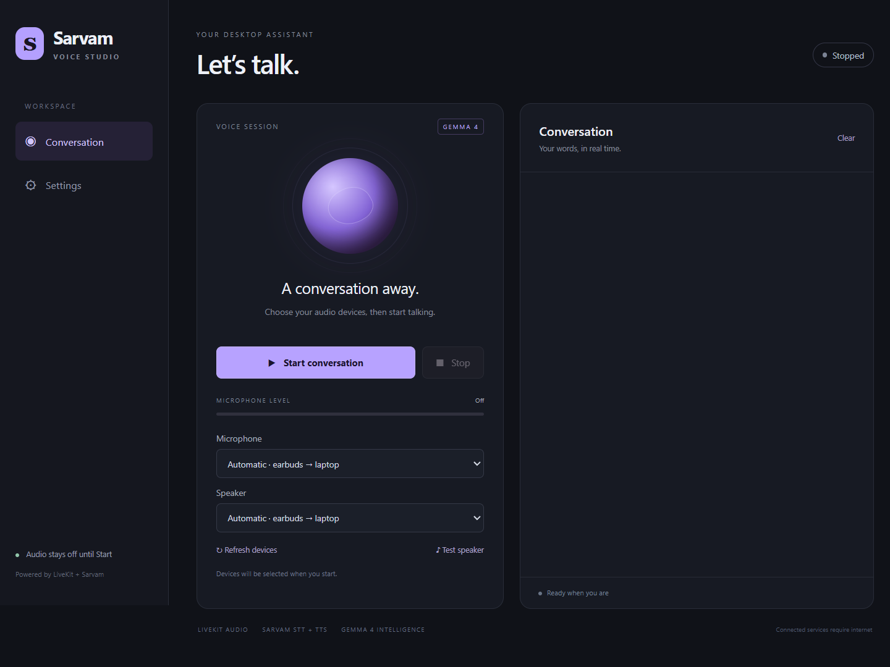

# Sarvam Voice — Windows desktop app

Electron desktop interface for a LiveKit Agents pipeline with Sarvam speech recognition,
Sarvam speech synthesis, and hosted Gemma 4 or a smaller local model through Ollama.



Features: Start/Stop controls, automatic earbuds/laptop audio selection, a live
microphone meter, conversation transcripts, a speaker test, multiple speech
languages, and Windows-encrypted API-key storage.

## Use the Windows app

Open `Sarvam-Voice-1.0.1-x64.exe` in the release-1.0.1 folder. This portable app bundles
Python and the voice backend; you do not need to install Python or Node.js to run it.
The app is unsigned, so Windows may show a publisher warning.

1. Open **Settings**. Enter your Sarvam API key and your LiveKit project URL,
   API key, and API secret. Choose a speech language and save.
2. Return to **Conversation**. Keep audio selection on Automatic or choose devices.
3. Use **Test speaker** to check playback, then **Start conversation**.
4. Speak after the greeting. Watch the microphone meter and conversation transcript.
5. Click **Stop** to release the microphone. Closing the app also stops its backend.

Settings are encrypted using Electron `safeStorage` and Windows account protection,
and saved under `%APPDATA%/Sarvam Voice/settings.enc`. No API keys are included
in the release or source archive. Conversation text is kept in memory, capped at 200
messages, and cleared when the app closes. Live audio and text are sent to the chosen
speech/model providers. Provider billing and internet access still apply.

Automatic audio selection prefers a complete CMF Buds 2a input/output pair, then the
laptop's Realtek pair, then Windows defaults. Remembered WDM-KS Bluetooth driver
entries are excluded. Connect/disconnect devices before starting; Stop and Refresh
to switch devices. A selected device disappearing during a session requires a restart.
The backend uses each device's native sample rate, addressing Bluetooth devices that
reject the terminal console's fixed sample rate.

For laptop speakers, leave **Allow me to interrupt** off. The microphone pauses while
the assistant replies to prevent its own voice becoming the next user turn. Enable
interruptions when using headphones. This is deliberate half-duplex behavior; the
app does not implement acoustic echo cancellation.

If the meter stays at Very quiet, check Windows microphone mute and privacy access.
If no audio frames arrive, the app warns you to reconnect or choose another microphone.
The app does not automatically change Windows mute or volume settings.

## Use a local small LLM

Install Ollama and run `ollama pull gemma4:e2b`. In Settings choose **Local model · Ollama**,
leave the server URL at `http://localhost:11434/v1`, and choose the installed model name.
Ollama must be running separately. Sarvam still supplies cloud STT/TTS. LiveKit Cloud
credentials are unnecessary for the local LLM desktop audio path.

## Develop from source

Use Node.js 22+ and Python 3.12+ on Windows x64.

```powershell
npm install
python -m venv .venv
.venv\Scripts\python.exe -m pip install -r backend/requirements.txt
$env:VOICE_AGENT_PYTHON = (Resolve-Path .venv\Scripts\python.exe).Path
npm start
```

The main process spawns the Python bridge over stdin/stdout JSON lines. Credentials
travel through the pipe rather than command-line arguments. A sandboxed renderer has
no Node.js access and uses a narrow, sender-checked preload API. The Python bridge
uses the LiveKit Agents session with direct desktop audio I/O; no room server is
required for this desktop microphone path. Hosted inference still uses LiveKit Cloud.

```powershell
npm test
.venv\Scripts\python.exe -m unittest discover -s backend -v
node tests/electron-smoke.cjs
```

Set `VOICE_AGENT_PYTHON` before the Electron UI test if using your own development venv.
The UI test uses a separate test profile and dummy credentials, with no live inference.

## Build a portable Windows executable

```powershell
.venv\Scripts\python.exe -m pip install pyinstaller
.\build-backend.ps1 -Python (Resolve-Path .venv\Scripts\python.exe).Path
npm run build
```

The backend is bundled into `runtime/voice-backend/`. Electron Builder embeds it in
the portable executable under `release-1.0.1/`. Keep the pinned versions and lockfile to
reproduce the build. No signing certificate is configured.

The source archive excludes `node_modules`, build caches, runtime binaries, credentials,
and release artifacts. The portable executable includes everything needed to launch.

## GitHub automation

The Source checks workflow runs the Node.js and Python unit tests on Windows for
pushes and pull requests. It needs no API keys. The manually triggered Build Windows
app workflow creates a portable executable and uploads it as a workflow artifact.
Build artifacts are excluded from Git; distribute the executable as a GitHub Release
asset instead of committing it. A new build must pass the frozen LLM-client self-test
to catch missing dependency metadata before packaging.

## References

- https://docs.livekit.io/agents/models/stt/sarvam/
- https://docs.livekit.io/agents/models/tts/sarvam/
- https://docs.livekit.io/agents/models/llm/ollama/
- https://www.electronjs.org/docs/latest/tutorial/security
- https://www.electron.build/docs/nsis/
